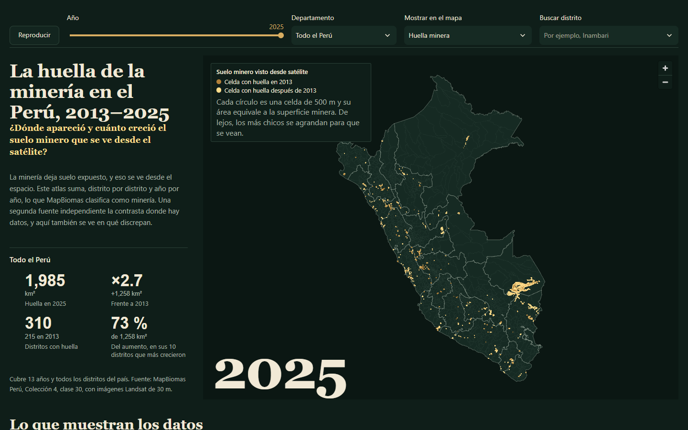
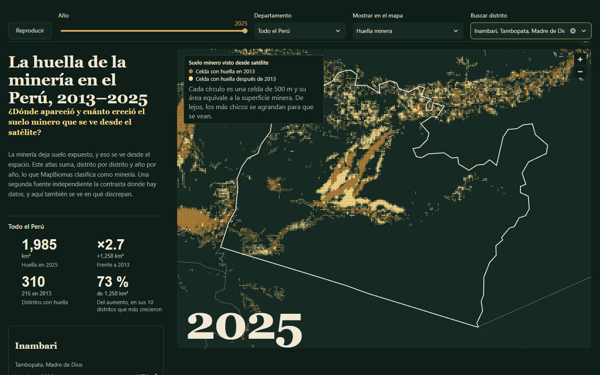

# La huella de la minería en el Perú, 2013–2025

Un atlas interactivo, distrito por distrito, del suelo minero que se ve desde el satélite. Cada cifra sale de datos públicos que este repositorio descarga y limpia. Una segunda fuente independiente contrasta el 41 % del aumento, y el proyecto publica también dónde discrepan.

**[Abrir el dashboard](https://huella-minera-peru.streamlit.app)** · **Publicación en LinkedIn:** se agrega al publicar

| | |
| :--- | :--- |
| **Autor** | Rodrigo Andrés Norabuena Mascaraqui ([@rodnm](https://github.com/rodnm)) |





## Tema y pregunta de investigación

**Tema:** expansión de la superficie minera en el Perú.

**Pregunta:** ¿dónde apareció y cuánto creció el suelo minero que se ve desde el satélite entre 2013 y 2025?

## Descripción del proyecto

La minería deja suelo expuesto, y eso se ve desde el espacio. MapBiomas Perú clasifica ese suelo cada año, pero publica el área solo por departamento. Este proyecto la calcula por distrito, la muestra en un mapa que avanza año por año y la compara con Amazon Mining Watch.

| Entrega | Dónde |
|---|---|
| Dashboard | [`dashboard/`](dashboard/), publicado en Streamlit Community Cloud |
| Reel de 9:16 con voz clonada | [`reel/`](reel/) |
| Datos procesados | [`datos/procesados/`](datos/procesados/) |
| Metodología y todos los hallazgos | [`docs/metodologia_y_hallazgos.md`](docs/metodologia_y_hallazgos.md) |

## Fuentes de datos y metodología

| Fuente | Uso | Fecha | Licencia |
|---|---|---|---|
| [MapBiomas Perú, Colección 4](https://peru.mapbiomas.org/descargas/mapas-de-las-colecciones/) | Huella anual, clase 30, a 30 m | 2013–2025 | CC BY 4.0 |
| [Amazon Mining Watch](https://source.coop/earthgenome/amazon-mining-watch) (Earth Genome) | Contraste independiente, cuenca amazónica, a 10 m | 2018–2024, versión del 16 oct 2026 | CC BY 4.0 |
| [Maus et al. (2022)](https://doi.org/10.1594/PANGAEA.942325) | Comparación de nivel | 2019 | CC BY-SA 4.0 |
| [NASA Black Marble VNP46A4](https://doi.org/10.5067/VIIRS/VNP46A4.002) | Capa de luz nocturna | 2013–2025 | Datos abiertos de NASA |
| [INEI, Mapa de Pobreza](https://www.gob.pe/institucion/inei/informes-publicaciones/3204872-mapa-de-pobreza-provincial-y-distrital-2018) | Capa de pobreza monetaria, con intervalo | 2018 | Información pública |
| [INGEMMET, GEOCATMIN](https://geocatmin.ingemmet.gob.pe/geocatmin/) | Límites distritales | Descarga de octubre de 2026 | Servicio público |

La URL, la fecha de descarga y el SHA-256 de cada archivo están en [`datos/originales/MANIFEST.json`](datos/originales/MANIFEST.json).

**Método, en corto:**

1. El mapa de 30 m de cada año se promedia sobre una grilla de 500 m. Esa fracción, multiplicada por el área real de cada celda, se suma por distrito.
2. El resultado se compara con la tabla oficial de MapBiomas: la diferencia nacional es de 0.25 % como máximo.
3. La tendencia en Madre de Dios, entre 2018 y 2024, se contrasta con Amazon Mining Watch, que usa otro satélite y otro modelo.
4. Las pruebas de [`tests/test_atlas_publicado.py`](tests/test_atlas_publicado.py) y [`tests/test_app.py`](tests/test_app.py) corren en cada cambio y fallan si los archivos publicados no coinciden con el panel o si un control deja de funcionar.

## Tres hallazgos principales

1. **La superficie clasificada como minera casi se triplicó:** de 727 a 1,985 km² entre 2013 y 2025 (×2.7), según MapBiomas.
2. **Madre de Dios explica el 63 % del aumento** y reúne el 57 % de la huella de 2025.
3. **El aumento está concentrado:** 10 distritos explican el 73 %. Inambari pasa de 88 a 417 km².

**El contraste:** Amazon Mining Watch se compara en Madre de Dios entre 2018 y 2024, un tramo que equivale al 41 % del aumento nacional.

| | MapBiomas | Amazon Mining Watch |
|---|---|---|
| Periodo completo, 2018–2024 | ×2.02 | ×1.98 |
| 2018–2021 | ×1.28 | ×1.52 |
| 2021–2024 | ×1.58 | ×1.30 |
| Área en 2024 | 1,023 km² | 1,520 km² |

Coinciden en la dirección y en el lugar: entre 96 % y 98 % de la superficie de MapBiomas cae en celdas con cicatrices. No coinciden en el nivel ni en el calendario, y fuera de Madre de Dios discrepan más.

## Limitaciones

- **No distingue minería legal, informal o ilegal,** e incluye extracción no metálica.
- **El área exacta está en discusión.** Maus et al. suma unas tres veces más en 2019, y el grupo de clases sin vegetación de MapBiomas, donde está la minería, tiene 74 % de exactitud de productor.
- **El 59 % del aumento no tiene contraste.** Se apoya sobre todo en MapBiomas.
- **Las fuentes no coinciden año a año ni fuera de Madre de Dios.** Este atlas no sirve para fechar un salto.
- **La luz y la pobreza son contexto.** Este trabajo no afirma que la minería reduzca o aumente la pobreza: los datos no alcanzan para saberlo, y la [metodología](docs/metodologia_y_hallazgos.md) explica por qué.

## Enlaces

- Dashboard: <https://huella-minera-peru.streamlit.app>
- Publicación en LinkedIn: se agrega al publicar

## Cómo reproducir

Requiere [uv](https://docs.astral.sh/uv/) y un token gratuito de [NASA Earthdata](https://urs.earthdata.nasa.gov) en un archivo `.env`, que git ignora, con la línea `BLACKMARBLE_TOKEN=...`.

```bash
uv sync
uv run python -m scripts.run_all    # unos 9 GB de descargas; reconstruye los datos del atlas
uv run pytest
uv run streamlit run dashboard/app.py
```

Solo para abrir el dashboard no hace falta descargar nada, porque sus datos están en `datos/atlas/`: `pip install -r dashboard/requirements.txt`. Para todo el proceso sin uv: `pip install -r requirements.txt`. El reel tiene su propio entorno, explicado en [`reel/README.md`](reel/README.md).

## Uso de inteligencia artificial

Usé Claude Code (Anthropic) como asistente para escribir código, documentar y revisar el análisis. Las decisiones de tema, alcance y mensaje fueron mías, y las cifras se comprueban con las pruebas y validaciones del repositorio. La narración del reel se generó con Qwen3-TTS a partir de una grabación de mi propia voz, y el video lo indica de forma visible.

## Contexto

El proyecto nació como trabajo final del curso Python Intermedio, de la Diplomatura de especialización en Ciencia de Datos para las Ciencias Sociales y la Gestión Pública (2026). El código del reel adapta el flujo de la sesión 15 de ese curso, como se indica en [`reel/recursos/CREDITOS.md`](reel/recursos/CREDITOS.md).
